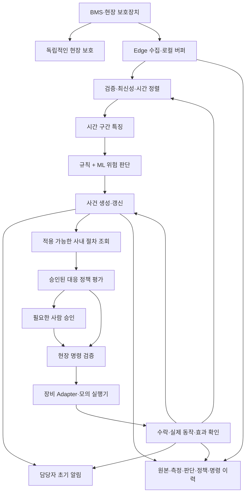

> 후속 구현: 작은 학습용 MVP는 `ess_mvp`에 구현했다. 현재 동작은 [MVP 가이드](mvp-guide.md)를 참고한다. 아래는 전체 현장 플랫폼의 설계 이력이며 전체 구현 완료를 뜻하지 않는다.

# ESS 장애 대응 자동화 플랫폼 설계안

작성일: 2026-10-17 (Asia/Seoul). 상태: 검토용 설계 제안. 이 문서는 기존 ETL 위에 추가할 플랫폼을 설명한다. 실시간 수집, ML 모델, 사내 문서 검색, 알림 전송, 실제 설비 제어는 아직 구현하지 않았다. 사내 문서나 실제 장비에는 접속하지 않았다.

## 1. 목표와 첫 구현 범위

목표 흐름은 `측정 → 품질 검사 → 특징/ML 판단 → 사건 생성 → 사내 절차 조회 → 정책 결정 → 허용된 대응 → 결과 확인 → 다음 측정`이다.

첫 PoC는 단일 ESS 사이트의 **온도 상승 이상 징후 감지와 냉각 관련 절차 안내·모의 대응**를 권한다. 일반적인 모든 배터리 장애 예측, 열폭주 예측, 실제 HVAC 제어를 첫 완료 조건으로 삼지 않는다. 실제 감독학습 예측의 대상과 예측 시간 범위는 현장 라벨을 확보한 뒤 확정한다.

### 구현된 부분과 추가할 부분

| 구분 | 상태/역할 |
| --- | --- |
| 기존 battery_etl | 구현됨. MAT 추출·검증·변환·PostgreSQL 적재, 과거 데이터 보존과 재처리에 활용 |
| 시간 순서 데이터 재생 | 신규. MAT 데이터의 재생 시각과 원천 시각을 구분; 실시간 수신 모사 |
| 현장 수집 | 신규. 제조사 메시지·단위·자산 식별자 확인 후 구현 |
| 특징/모델 | 신규. 관측 가능한 입력과 실제 장애 라벨에 따라 결정 |
| 문서 검색 | 신규. 승인된 사내 문서의 권한·적용 대상·버전 확인 |
| 대응 정책/실행 | 신규. 승인된 행동 목록과 장비 인터페이스 기반 |
| 알림/관제 | 신규. 담당자·당직·에스컬레이션 정책에 따른 이력과 전달 확인 |

기존 모델/특징이 이미 존재한다고 가정하지 않는다. 기존 summary를 새 장애 라벨로 간주하지 않는다.

## 2. 아키텍처



현장 보호는 문서 검색, ML 추론, 중앙 DB, 알림 서비스에 의존하지 않는다. 상위 플랫폼은 BMS/PCS 인터록을 해제하거나 보호 한계를 바꾸지 않는다. Edge에서 최신 상태와 제어 권한을 최종 확인한다. 중앙 서버의 판단이 내려진 뒤 현장 상태가 바뀌면 명령을 거부한다.

초기 배포는 현장 Edge 프로세스와 중앙 Python Worker/관제 경계로 나눈다. 중앙 코드는 모듈로 분리한 단일 애플리케이션으로 시작하고 PostgreSQL을 사용한다. 초기 구현에 Kafka/Airflow/Kubernetes/LLM 프레임워크를 필수로 도입하지 않는다. 조회 API/웹 UI와 추가 인프라는 별도 개발 범위로 정한다.

## 3. 수집과 데이터 계약

장비 프로토콜을 확인하기 전 실제 필드명·단위·DB DDL을 확정하지 않는다. 다음은 계약에 필요한 논리적 정보다.

- 실제 자산 계층: 사이트, 컨테이너, 랙, 모듈/셀, 연결된 PCS/냉각 장비.
- 장비 측정 시각과 서버 수신 시각, 시계 동기화 상태.
- 안정적인 이벤트 ID 또는 장비/실행 세션/순번 조합. 재부팅과 순번 초기화 포함.
- 측정 단위·배율·부호, 원천 payload, 메시지 형식 버전.
- 센서 품질 플래그, 누락/지연/중복/장비 연결 상태.
- 장비 운전 모드, 제어 권한, 보호 이벤트와 관련 설비 상태.

수신 확인은 수신 측 영속 저장을 확인한 뒤 수행한다. 재전송·재연결 후 복구를 허용하고 중복은 식별자로 제거한다. 같은 ID인데 내용이 다르면 조용히 덮어쓰지 않는다. 수신 속도가 처리 속도를 넘을 때 로컬 디스크/버퍼 용량, 적체 경보, 수신 제어와 운전 제한 정책을 정한다.

늦게 도착한 데이터는 event time 기준으로 처리하고 허용 지연 범위/집계 수정 규칙을 버전 관리한다. 과거에 확정한 특징과 예측을 조용히 수정하지 않고 수정 이력을 연결한다. 과거 데이터 재생은 별도 실행 모드로 두고 실제 명령 경로를 비활성화한다.

현재 오프라인 ETL의 `diff(t) < 0` 규칙을 수신 순서에 그대로 적용하지 않는다. 장비 시간 오류, 네트워크 순서 역전, 부동소수점 차이를 분리한다.

## 4. 무엇을 보고 ML이 판단하는가

아래는 **입수 여부 확인이 필요한 후보**이며 현재 실시간 데이터에 이미 있는 컬럼이 아니다.

| 신호/문맥 후보 | 특징 후보 | 판단에서의 의미/주의 |
| --- | --- | --- |
| 배터리 온도 | 과거 구간의 상승률, 최댓값, 변동 | 단독으로 원인/열폭주를 확정하지 않음 |
| 같은 랙의 동기화된 센서 | 온도·전압 편차 | 실제 토폴로지와 동시 측정이 필요. 독립 실험 셀을 랙으로 묶지 않음 |
| 전압·전류 | 변화량, 전류 조건에 따른 반응 | 부호·운전 구간·장비 한계를 확인 |
| 주변 온도·냉각 입출구 | 배터리-주변 차이, 냉각 전후 차이 | 냉각 관련 원인 판단에 추가 문맥 제공 |
| 냉각 장비 상태 | 요청과 실제 동작의 불일치 | 배터리 자체 이상과 냉각 설비 문제 구분에 활용 |
| SOC·운전 모드·부하 | 조건별 기준선과 잔차 | 운전 조건에 의한 정상 변화를 이상으로 판단하지 않도록 함 |
| 보호/고장 코드·점검 기록 | 사건 종류·발생 시각·확정 원인 | 감독학습의 라벨 근거 후보 |

특징은 예측 시점 이전 데이터만 사용한다. 입력 구간, coverage, 누락, 기준 시각, 특징 버전을 저장한다. 수집되지 않은 신호를 추정값으로 채워 실제 측정처럼 사용하지 않는다.

### 모델 선택과 출력 계약

| 확보 데이터 | 첫 접근 | 말할 수 있는 결과 |
| --- | --- | --- |
| 정상/운전 데이터만 있음 | 운전 조건별 기준선 + Isolation Forest 등 이상 탐지 baseline | 정상 패턴과 다른 정도; 장애 확률이 아님 |
| 고장 종류와 시각이 검증된 라벨 있음 | 구간 특징 기반 로지스틱 회귀/트리 계열 baseline 비교 | 검증된 특정 사건의 지정 시간 범위 내 발생 위험 |
| 충분한 독립 장비·다양한 고장 이력 있음 | 필요 시 시계열 모델과 비교 | baseline 대비 이점이 확인된 범위만 채택 |

첫 단계에서 복잡한 시계열 신경망을 확정하지 않는다. 필요한 예측 선행 시간은 관측 가능한 전조와 실제 대응 소요 시간으로 정한다. 특정 분 단위 예측이나 임의의 위험 확률을 보장하지 않는다.

예측 결과에는 대상 자산, 평가 시각/입력 구간, 사건 종류, 예측 시간 범위, score 종류, 모델/특징 버전, 입력 품질, 판단 근거와 적용 가능 상태를 연결한다. 데이터 부족/운전 영역 이탈 시 `판단 불가`를 반환하고 정상으로 표시하지 않는다. 원인 확신이 없는 이상은 문서 검색에서도 확정 고장으로 취급하지 않는다.

### 학습·검증

- 고장 정의, 예측 시간 범위, 전문가 확인 라벨, 관측 종료/불명확 사례 취급을 먼저 정한다.
- 같은 장비와 겹치는 시계열 구간이 학습/평가에 섞이지 않도록 장비 분리와 시간 분리를 함께 고려한다. 구간/미래 라벨이 겹치는 분할 경계도 제거한다.
- 결측 처리·스케일링 등 전처리도 학습 구간에서만 적합한다.
- 단순 accuracy보다 사건별 recall/precision, 자산·시간당 오경보, 경고 선행 시간, 확률 calibration, 판단 불가 비율을 평가한다.
- 운전 조건/센서/배터리 종류가 바뀌면 입력 분포와 성능을 추적한다.
- 새 모델은 검토·Shadow 실행·승인 후 배포하며 실시간 관측만으로 자동 재학습·자동 승격하지 않는다.

현재 Stanford MAT는 열화·사이클 데이터다. 냉각 장비, 사내 고장 확정 이력과 실제 제어 반응은 확인되지 않았다. 현재 데이터는 재생/수집/특징 파이프라인 검증에 활용할 수 있지만, 그 결과를 현장 장애·화재 예측 성능으로 주장하지 않는다. 합성 고장/시뮬레이터도 통합 로직 검증용이며 현장 예측 검증을 대체하지 않는다.

## 5. 사내 문서 검색과 RAG의 역할

장애가 확정된 뒤에만 검색하는 대신, 위험 징후 사건을 생성한 시점부터 관련 절차를 조회한다. 초기 알림과 기존 보호 동작은 검색 완료를 기다리지 않는다.

문서 입력은 운영 절차, 제조사 매뉴얼, 설비 점검서, 고장 코드 표, 승인된 사고 대응 절차와 과거 사건 이력이다. 문서 등록 시 다음을 관리한다.

- 문서 ID/버전/해시, 승인 상태, 유효 기간, 폐기/대체 여부.
- 적용 사이트·자산 모델·배터리 종류·펌웨어와 운전 조건.
- 고장/위험 유형, 담당 조직, 사용자 접근 권한.
- 원문 링크·페이지/절·문단과 검색 인덱스의 연결.

검색 순서는 `권한/승인/적용 대상 필터 → 고장 코드/메타데이터/키워드 검색 → 필요하면 의미 검색 보완 → 근거 절 반환`으로 한다. 한국어 문서 검색 품질은 실제 문서로 평가한다. 검색 문서를 인덱싱할 권한과 최종 수신자가 원문/요약을 볼 권한도 구분한다.

결과는 해당 절차와 일치 근거, 적용 조건, 금지 조건, 버전과 원문 위치다. 문서가 없거나 충돌/폐기/불일치하면 `자동 대응 근거 부족`으로 분류하고 담당자에게 넘긴다. 문서 갱신은 연결된 정책의 재검토를 요구한다.

LLM은 선택 사항으로, 근거가 있는 설명/알림 초안을 만들 수 있다. LLM이 새 제어값·명령을 생성하거나 문서 본문이 도구 실행 권한을 바꾸도록 허용하지 않는다. 문서는 데이터이며 실행 지시로 취급하지 않는다.

**문서 검색과 정책 실행은 별도다.** 문서의 '냉각 조치 검토' 문구를 즉시 장비 명령으로 바꾸지 않는다. 전문가가 문서에 근거해 승인한 정책 ID/버전과 허용 행동을 사전에 등록한다. 검색은 그 근거를 제시하고 적용성을 확인하는 역할이다.

## 6. 대응 결정과 실행

정책 입력은 현재 자산 상태, 데이터 최신성, 모델 출력/적용 가능성, 위험 종류, 유효한 정책/근거 문서, 운전 모드와 제어 권한이다. 출력은 `관찰 유지`, `알림/점검 요청`, `사람 승인 필요`, `승인 범위 내 행동 요청`, `근거 부족/보류` 중 하나다. 특정 ML 점수만으로 물리 행동을 실행하지 않는다.

### '공장 온도를 낮춘다'의 구체화

첫 대상은 해당 ESS와 연결된 냉각 설비로 한정하는 안을 권한다. 공장 전체 HVAC가 적절한 대응 설비인지는 현장 설계에서 확인해야 한다.

자동 실행은 아래 조건이 모두 확인된 행동만 대상으로 한다.

1. 위험 유형과 해당 자산에 적용되는 승인 정책·문서가 있다.
2. 배터리/냉각 장비 데이터가 최신이고 필요한 센서가 유효하다.
3. 대상 장비가 승인된 원격 운전 모드이며 제어 권한이 있다.
4. 장비 제조사 허용 범위와 승인된 변경폭/빈도/지속 시간 안이다.
5. 보호 인터록, 현장 수동 제어, 다른 운영 명령과 충돌하지 않는다.
6. 가스/화재/비상 상태처럼 별도 대응 절차가 필요한 조건이 아니다.

실제 설정값과 제조사 API 명령은 정하지 않았다. 냉각이 모든 고장이나 열폭주에 유효하다고 가정하지 않으며, 비상 관련 공조/환기/차단은 승인된 현장 절차를 따른다. 자동 복구/재가동 허용 조건은 별도로 승인해야 한다.

### 명령 수명

`요청 → 정책 검증 → 필요한 승인 → 현장 재검증 → 전송 → 장비 수락 → 실제 동작 확인 → 효과 확인 → 완료/상위 대응`

명령에는 고유 ID, 사건 ID, 자산, 정책/근거 버전, 판단 시점 상태, 요청자/승인자, 유효기간, 예상 상태 조건을 연결한다. 제어 권한을 가진 실행 주체를 조정하고, 장애 복구 후 오래된 주체가 계속 명령하지 못하도록 현장 권한/세션을 확인한다.

DB UNIQUE만으로 물리 동작의 단 한 번 실행을 보장하지 않는다. 장비가 명령 ID를 지원하는지 확인하고, 응답 유실 시 현재 상태를 조회해 결과를 대조한다. 결과가 불명확하면 무조건 재전송하지 않는다. 결과 불명·실패는 별도 상태이며 자동으로 성공 처리하지 않는다.

## 7. 닫힌 루프와 알림

매 측정마다 새로운 명령과 알림을 생성하지 않는다. 자산/위험 유형별 열린 사건을 갱신하고 심각도 상승·상태 변경·결과 변경을 기록한다. 사건 중복 방지와 제어 cooldown, 최대 시도 횟수, 관찰 기간, 상위 대응 조건을 정책에 둔다. 상위 운영 경보의 히스테리시스/지속 조건은 현장 즉시 보호 동작에 지연을 추가하지 않는다.

행동 후에는 다음을 각각 확인한다.

- 장비가 명령을 수락했는가?
- 팬/펌프/설정 상태 등 실제 피드백이 바뀌었는가?
- 승인된 관찰 범위에서 배터리/설비 지표가 어떻게 변했는가?
- 데이터가 계속 유효한가? 새로운 위험/보호 상태는 없는가?

한 번 값이 내려갔다고 원인 해결이나 냉각 조치의 인과 효과가 입증됐다고 보지 않는다. 위험 증가, 효과 미확인, 명령 실패, 센서 장애는 에스컬레이션한다. 사건 종결·운전 복귀 조건을 분리하고, 중요한 사건은 수동 확인을 요구하는 정책을 둔다.

알림은 사건 생성 시 초기 알림, 대응 요청/승인, 실행 결과, 악화/미확인 시 에스컬레이션, 최종 사건 요약으로 구분한다. 자산·위험 종류·측정 근거·모델/정책 버전·문서 근거·실행 상태·담당자 링크를 포함하되 수신 권한을 확인한다.

사건 전이와 알림 요청(outbox)을 함께 commit하고 별도 notifier가 전송/재시도한다. 전송과 사람이 확인한 것을 구분하고, 미확인 시 당직/상위 담당자에게 넘기는 정책을 둔다. 실제 이메일/메신저 발송은 연결과 수신자·전송 조건을 확정한 구현 단계에서 수행한다.

## 8. 저장 영역과 추적성

실제 DDL이 아닌 논리적 영역이다. 기존 source_files/cells/cycles를 즉시 수정하지 않고 실제 자산·실시간 이벤트 영역을 추가 설계한다.

| 영역 | 추적할 내용 |
| --- | --- |
| 자산/토폴로지 | 실제 장비 ID, 설치/교체 이력, 냉각 장비 연결 |
| 원본/측정/품질 | 이벤트 ID, 시각, payload, 검증 결과와 정제 조치 |
| 특징/모델/예측 | 입력 구간과 원천, 버전, score 종류, 적용 가능 상태 |
| 사건 | 위험 종류, 심각도, 담당자, 상태 전이와 종료 근거 |
| 문서/검색 근거 | 승인/적용성/ACL/원문 절, 검색 버전과 결과 |
| 정책/결정 | 승인된 행동, 전제/금지 조건, 정책 버전과 평가 결과 |
| 명령/실행/결과 | 요청·승인·수락·실제 동작·효과·실패/불명 상태 |
| 알림/outbox/감사 | 요청/전달/확인/에스컬레이션, 변경자와 변경 시각 |

사건 하나에서 `원본 → 특징 → 모델 출력 → 문서 절 → 정책 판단 → 명령 → 장비 결과 → 알림`을 연결할 수 있어야 한다. 최종 설명은 당시 버전으로 재현한다. 문서/정책/모델 변경으로 과거 판단을 덮어쓰지 않는다.

## 9. 제안 코드 구조와 계약

```text
src/
  battery_etl/                   # 기존 구현
  ess_response/                  # 아래는 신규 제안
    contracts.py                 # 실제 장비 계약 확인 후 이벤트/사건/행동 타입
    ingest.py                    # 수신·중복·원본 보존
    quality.py                   # 온라인 품질·최신성·시각 처리
    features.py                  # 과거 구간 기반 특징
    inference.py                 # 모델 로드·적용 가능성·추론
    incidents.py                 # 사건 생성/갱신/종결
    knowledge.py                 # 권한·버전·적용성 기반 문서 조회
    policy.py                    # 승인 정책 평가
    command_gateway.py           # 현장 권한/최신 상태 재검증
    feedback.py                  # 실제 동작/효과 확인
    notifier.py                  # outbox·재시도·확인/에스컬레이션
    worker.py                    # 지속 실행과 재시작 복구
    adapters/                    # 제조사·통신·알림별 경계
    simulation/                  # 시간 재생·가상 장비·결함 주입
```

| 제안 함수 | 입력 → 출력 |
| --- | --- |
| accept_event | 원천 메시지/장비 계약 → 영속 원본 ID와 수신 결과 |
| validate_event | 이벤트/자산 설정/최신성 규칙 → 품질 상태·이슈 |
| build_features | 과거 유효 측정 구간/특징 버전 → 특징과 입력 coverage/근거 |
| predict_risk | 특징/모델/자산 문맥 → 위험 점수 종류·대상 사건·적용 가능 상태 |
| upsert_incident | 위험 결과/열린 사건 → 새 사건 또는 상태 전이 |
| retrieve_procedure | 사건/자산/권한/문서 버전 → 적용 가능한 근거 절 또는 근거 부족 |
| evaluate_policy | 사건/근거/현장 상태/정책 → 허용·보류·승인 필요와 행동 요청 |
| request_action | 행동 요청/권한/최신 상태 → 거부·명령 ID·실행 상태 |
| verify_outcome | 명령/장비 피드백/새 측정 → 동작·효과 확인 또는 실패/불명 |
| deliver_notification | outbox/연락 정책 → 전달 상태·재시도·상위 알림 요청 |

이는 함수 설계이며 현재 존재하는 코드가 아니다. 초기에는 명시적 상태/작은 함수로 연결하고 Agent가 임의의 도구 순서를 선택하도록 하지 않는다. 기존 offline validator에서 재사용 가능한 수치 검사만 분리해 테스트하고, 온라인 시간 처리/품질 정책은 별도로 둔다.

## 10. 개발 단계와 통과 조건

| 단계 | 구현 | 통과 조건 |
| --- | --- | --- |
| A. 계약·위험 정의 | 장비/목표 고장/지연/정책/문서 권한 정리 | 입력과 제어 책임, 금지 조건, 평가 방법 합의 |
| B. 재생·수집·품질 | 기존 MAT replay와 별도 가상 실시간 이벤트, 원본/품질 저장 | 중복/지연/누락/재시작 검증, 실제 센서인 것처럼 합성값을 표시하지 않음 |
| C. 탐지/모델 baseline | 규칙·이상 탐지, 라벨 있으면 특정 사건 예측 | 독립 장비/시간 평가, 오경보·선행 시간·판단 불가 보고 |
| D. 문서 기반 권고 | 승인 문서 검색, 정책 제안, 사건/알림 모의 | 올바른 절/버전/권한/적용성 평가; 문서 부재·충돌 시 보류 |
| E. 모의 닫힌 루프 | 가상 장비 명령·상태·효과·에스컬레이션 | 중복 제어/반복 알림/오래된 명령 차단, 결과 불명 처리 |
| F. 현장 Shadow | 읽기 전용 실제 수집, 예측·권고만 생성 | 담당자와 판단 대조, 제조사/설비 운영·안전 검토 |
| G. 제한된 제어 | 승인된 대상·범위·상황의 현장 대응 | 인터록/권한/실패/수동 우선/복귀 조건과 실제 결과 확인 |

각 단계에 Pytest 단위 테스트와 DB/Adapter 통합 테스트를 둔다. 실제 장비 제어 시험은 전문 담당자의 절차/권한 아래 별도 수행한다.

필수 시나리오: 중복 이벤트, 순서 역전, 오래된 측정, 센서 고착/누락, 모델 오류/영역 이탈, 만료/상충 문서, 권한 없는 검색, 문서 내 악성 지시, 명령 중복, ACK 유실, 장비 거부, 효과 없음/악화, 처리 중 재시작, DB 단절, 알림 실패/미확인, 제어 주체 중복, replay 모드에서 실제 제어 차단. 테스트 결과를 예측 성능·문서 정확성·제어 신뢰성으로 구분해 보고한다.

## 11. 구현 전 필요한 자료와 우선 결정

1. 실제 장비인가, 실험/시뮬레이터인가? BMS·PCS·냉각 설비와 통신 문서는 무엇인가?
2. 첫 대상 고장은 온도 이상, 냉각 고장, 셀 불균형 등 무엇인가? 어떤 근거로 발생을 확정하는가?
3. 측정 빈도/장비 수/허용 지연, 고장 이력과 대응 기록은 어느 정도 있는가?
4. 승인된 사내 절차의 보관 위치·권한·버전·적용 장비·담당자는 누구인가?
5. 자동 실행 가능한 행동과 사람 승인이 필요한 행동, 인터록/수동 우선/복구 기준은 무엇인가?
6. 알림 채널, 당직·상위 담당자, 확인/재시도 정책은 무엇인가?

이 정보 없이 실제 설정 온도, 임계 위험 확률, 예측 시간, 자동 복귀 조건을 임의 확정하지 않는다. 첫 MVP의 성공은 재현 가능한 사건 하나를 끝까지 추적하는 것이다. 실제 설비를 안정화했다는 주장은 별도의 현장 검증 결과로만 한다.

## 12. 참고 근거

- [Sandia: Detecting battery failures quicker](https://newsreleases.sandia.gov/battery-failures/): 배터리 전조는 고장 양상·센서·배터리 종류에 영향을 받고 경고 선행 시간과 진단 한계를 검증해야 함. 특정 플랫폼 성능을 증명하는 자료는 아님.
- [NIST SP 800-82 Rev.3](https://csrc.nist.gov/pubs/sp/800/82/r3/final): OT의 안전·신뢰성·가용성과 보안 요구를 함께 고려하는 기반 지침.
- [scikit-learn IsolationForest](https://scikit-learn.org/stable/modules/generated/sklearn.ensemble.IsolationForest.html): 이상 탐지 score/판정의 의미. 장애 확률로 직접 해석하지 않음.
- [scikit-learn TimeSeriesSplit](https://scikit-learn.org/stable/modules/generated/sklearn.model_selection.TimeSeriesSplit.html): 시간 순서 평가의 참고. 장비 분리/겹침 제거는 추가 설계 필요.
- [국가법령정보센터 NFPC 607](https://www.law.go.kr/admRulLsInfoP.do?admRulSeq=2100000278596): 국내 현장 적용 시 적용 범위와 현행 설치·관리 기준 검토. 제조사 요구/현장 위험 평가와 함께 판단.

위 자료는 설계 배경이다. 구체 모듈 구성·단계·정책 경계는 이 프로젝트를 위한 제안이며 인증/현장 안전성 검증 완료를 뜻하지 않는다.
